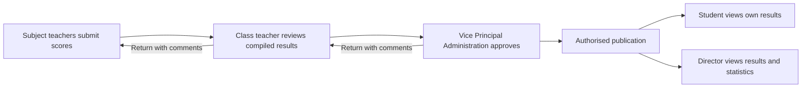
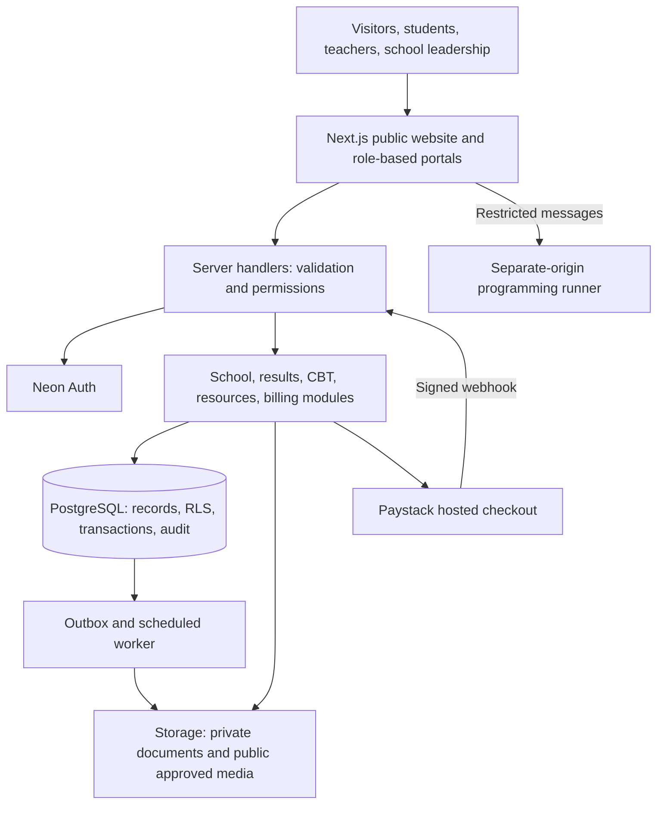

# BrainField Schools

**A school website and management platform for a Nigerian secondary school, designed by former students giving back to their school.**

BrainField Schools brings the public school website, academic administration, examinations, classroom resources, and school billing into one platform with separate workspaces for the people who use it.

> **Project status: landing-page implementation.** The Next.js website includes the supplied school logo, both Lagos campuses, telephone links, verified public student-event photographs, and source-linked historical achievements. Neon PostgreSQL/Auth connection code is prepared but no Neon instance or school database is connected. Portals, payments, and student-data workflows remain planned. No production deployment or school endorsement is claimed.

## Documents

| Document | Purpose |
| --- | --- |
| [System architecture](docs/SYSTEM-ARCHITECTURE.md) | Components, permissions, data model, workflows, security, operations, and Mermaid diagrams |
| [Architecture PDF](docs/BrainField-Schools-System-Architecture.pdf) | Shareable PDF of the architecture, with rendered diagrams |
| [Build guide](docs/BUILD-GUIDE.md) | Practical instructions for a two-person team, milestones, acceptance criteria, testing, and launch |
| [Build guide PDF](docs/BrainField-Schools-Build-Guide.pdf) | Printable copy of the implementation guide |
| [Decision register](docs/DECISIONS.md) | Agreed requirements, proposed choices, and questions for school leadership |
| [Design guidance](DESIGN.md) | Green, red, and white palette, responsive layouts, accessibility, and interface states |
| [Contributing](CONTRIBUTING.md) | Collaboration, review, and documentation workflow |
| [Neon setup](docs/NEON-SETUP.md) | Database/Auth connection boundary, configuration, and remaining account setup |
| [School media and 2025 results](docs/SCHOOL-MEDIA.md) | Uploaded photo provenance, original school posters, retrieval status and privacy exclusions |
| [React Bits integration](docs/REACT-BITS.md) | Fade Content adaptation, accessibility behaviour and third-party licence |
| [Photograph provenance](docs/PHOTO-SOURCES.md) | Public photo sources, identity checks, contextual captions, and usage scope |
| [School content sources](docs/CONTENT-SOURCES.md) | Supplied identity/contact details, verified historical achievements, and source caveats |
| [Landing-page and Gallery research](docs/LANDING-RESEARCH.md) | Pinterest/web inspiration, newer achievement sources, official YouTube films, and the original 2025 research history |

## 1. Purpose and boundaries

The platform should reduce repeated paperwork, make approved results accessible, support teaching and assessment, and give school leadership reliable information. It starts with one school. Multiple schools, mobile apps, and complex infrastructure are future possibilities, not initial requirements.

The school remains responsible for its academic policies, published claims, approved content, student records, payment accounts, and authorised staff assignments. Developers implement and maintain the agreed system.

**Learning progress reports have been removed from scope.** The director's result statistics are an administrative feature; they do not introduce personalised learning progress reports or automated learning recommendations.

## 2. Confirmed feature scope

| Module | Planned capabilities |
| --- | --- |
| Public school website | About the school, laboratories, facilities, awards, verified JAMB results, contact information, and approved photographs |
| Student portal | Published results, school timetable, assignments, CBT access, ICT notes, personal study timetable, and bills |
| Teacher portal | Assigned subjects/classes, score entry, assignment management, question authoring, and teaching resources |
| Class teacher workspace | Compile class results, check completeness, add permitted comments, approve, or return submissions for correction |
| Vice Principal (Administration) workspace | Review class-approved results, return them for correction, and provide final academic approval |
| Principal/proprietor administration | School configuration, staff assignments, academic sessions, classes, and oversight according to granted permissions |
| Separate director dashboard | View results and result statistics by class, subject, term, and academic session; approval-status visibility |
| CBT | Scheduled examinations, practice tests, question bank, timed attempts, answer saving, and controlled release of scores |
| School timetable | Class schedules, subject teachers, rooms, breaks, and conflict checks |
| Personal study timetable | Student-created study sessions, available hours, subject priorities, and editable schedules |
| Results | Score upload/entry, validation, staged approval, publication, report cards, and controlled corrections |
| Assignments | Teacher-created tasks, due dates, submissions, marking, and feedback |
| Competition classes | Configurable qualification cutoffs, selection tests, practice, and reviewed membership |
| ICT e-notes | Structured notes organised by class, term, and topic with teacher publishing controls |
| Programming classroom | Code editor, exercises, output, saved submissions, and teacher review |
| School fees and other bills | Itemised invoices, online payment, receipts, balances, reconciliation, and controlled adjustments |

### Result approval is a core requirement

**Subject teachers submit scores → class teacher reviews and approves compiled results → Vice Principal (Administration) gives final approval → results are published.**

The director has a separate dashboard for viewing results and statistics. Being a director does not automatically grant score editing or approval rights. Final approval and publication are recorded separately, even if school policy permits one authorised action to perform both.



### Proposed additions requiring school agreement

Parent/guardian portal, attendance, announcements/calendar, admissions, library management, clubs, document requests, and promotion/graduation tools are suggestions. They are not assumed to be approved. A bursar/finance role is recommended for billing duties. Parent access must be based on verified guardian relationships.

## 3. Recommended stack

Neon PostgreSQL and Neon Auth are confirmed provider choices. The landing page uses pinned Next.js, React, Tailwind, and Radix icons; the remaining module choices are proposals. Confirm school policies during discovery.

| Layer | Recommendation | Reason |
| --- | --- | --- |
| Language/runtime | TypeScript; Node.js 24 LTS | One language across the web application; supported runtime |
| Application | Next.js App Router and React | Public website, portal pages, and server endpoints in one codebase |
| Styling | Tailwind CSS, accessible Radix primitives | Consistent responsive interfaces with the approved green, red, and white styling |
| Forms/validation | React Hook Form and Zod | Clear form errors and shared input schemas; repeat validation on the server |
| Database | Neon-managed PostgreSQL | Relational academic records, constraints, transactions, SQL reporting |
| Identity | Neon Auth with server-side session handling | Staff invitations, student accounts, password recovery, privileged-user MFA |
| Authorisation | Server checks and PostgreSQL row-level security | Restrict records by school, role, assignment, and ownership |
| Files | Private object storage (provider to be configured) | Private report cards/submissions; separate approved public media |
| Payments | Paystack hosted checkout | Keep card entry with the provider; verify and reconcile on the server |
| Charts | Recharts | Director statistics with accessible table alternatives |
| Editor | CodeMirror 6 | Programming editor, loaded only on programming pages |
| Code execution | Separate-origin browser runner initially | Classroom practice without running student programs on the app server |
| Testing | Vitest, Testing Library, Playwright, SQL/RLS tests | Cover academic rules, permissions, and complete user workflows |
| Hosting | Vercel for the web app; Neon for database and authentication | Managed services with separate staging and production environments |
| Background work | PostgreSQL job/outbox tables plus scheduled worker | Retryable notifications, reports, reconciliation, and exam finalisation |
| Source control | GitHub and GitHub Actions | Reviewed changes, automated checks, and release records |

Neon Auth establishes identity; school roles remain in application-owned PostgreSQL tables. Neon does not automatically set the identity context for application RLS. The Next.js server owns business operations. Use PostgreSQL functions for atomic score transitions, publication, and payment allocation. Do not add microservices, Redis, Kubernetes, a second backend framework, or a native app at the start without a demonstrated need.

## 4. System overview



See the architecture document for detailed diagrams and trust boundaries.

## 5. Role principles

- Subject teachers manage only their assigned class-subject offerings.
- Class teachers review only their assigned classes; corrections go back to the originating teacher.
- The Vice Principal (Administration) is the final result approver.
- A separate publication permission controls student release.
- The director sees authorised school-wide results and statistics, with approved/published status clearly distinguished.
- Students see only their own published results, submissions, bills, and permitted learning resources.
- Principal, proprietor, director, Vice Principal, and technical administrator are distinct roles. One person may hold several explicitly granted roles.
- Role names or hidden buttons are insufficient protection: every server operation and database policy must enforce access.

## 6. Nigerian school context

Support JSS/SSS and school-specific class streams, three terms where applicable, configurable continuous assessment and examination components, subject registration, promotion policies, and academic sessions. Do not assume a universal CA/exam ratio or grade boundary.

Display dates and schedules in `Africa/Lagos`; store timestamps in UTC. Store money as integer kobo with a currency code. Design for affordable Android phones, shared ICT-lab computers, uneven connections, and printed reports. Public JAMB highlights must be accurate and approved for publication. Do not imply an official JAMB integration.

## 7. Delivery plan

| Stage | Deliverable | Completion gate |
| --- | --- | --- |
| Discovery | Policies, role matrix, prototype, content inventory | School signs off workflow and pilot scope |
| Foundation | Website, accounts, classes, terms, assignments of staff | Permissions tested with separate accounts |
| Academic MVP | Results workflow, director dashboard, report cards | Pilot class completes entry through publication |
| Classroom tools | Timetables, assignments, ICT notes, study planner | Teachers and students complete real tasks |
| Assessment | CBT practice/exams, competition selection | Recovery and concurrent-attempt tests pass |
| Finance | Invoices, Paystack integration, reconciliation | Duplicate events and mismatched payments cannot credit fees |
| Programming | Isolated runner, exercises, submissions | Runner isolation and resource controls verified |
| Launch | Migration, training, monitoring, restore drill | School accepts pilot and operational handover |

An illustrative two-person schedule is 14–22 calendar weeks for the confirmed scope if both developers have relevant experience and school feedback arrives promptly. It is an estimate, not a deadline. A narrower academic MVP can be released earlier. Optional additions require separate estimates.

## 8. Run the website and maintain documentation

The landing page runs without database secrets. From the repository root:

```sh
npm ci --prefix apps/web
npm run dev
```

Open http://127.0.0.1:3001. For production verification use `npm run lint`, `npm run typecheck`, and `npm run build`. Browser checks run with `npm run test:e2e`; install Playwright Chromium first if needed. The initial portal route clearly explains that access is not available yet.

The Gallery is at `/gallery`, with category, year, and student/story search filters. It includes newer source-linked science highlights and official YouTube videos that load on request. The homepage has a dedicated 2025 JAMB area; the school-published posters now provide two attributed 364/400 highlights and the public cohort posters in the photo archive. Historical 2022 scores appear only in the dated archive. Public Gallery entries are maintained in `apps/web/src/content/gallery.ts`; no private student-result database is exposed.

See [Neon setup](docs/NEON-SETUP.md) for the server-only database/Auth configuration, [content sources](docs/CONTENT-SOURCES.md) for verified school facts and achievements, and [the build guide](docs/BUILD-GUIDE.md) for later phases. The public page does not require or invent a database connection. Robots indexing is disabled until school review.

To regenerate the PDFs using Python 3.11 or newer:

```sh
python -m venv .venv
# Windows PowerShell:
.venv\Scripts\Activate.ps1
# macOS/Linux: source .venv/bin/activate
python -m pip install -r requirements-docs.txt
python scripts/build_documents.py
python scripts/check_documents.py
```

Mermaid source files are in `docs/diagrams/`; the corresponding Mermaid code is embedded in the architecture document for GitHub rendering. Static SVGs and high-resolution PNGs in `docs/diagrams/rendered/` are generated from those Mermaid sources. The PDF generator embeds the PNG versions. Rendering requires Mermaid CLI and Chromium as explained in the build guide.

## 9. Public repository and ownership

Only documentation, application source, synthetic fixtures, and sanitised configuration examples belong in this public repository. Never commit student records, staff credentials, real results, payment exports, private photos, database backups, or environment files.

Public visibility is not the same as an open-source licence. **No open-source licence is granted in this initial repository.** Before implementation or sale, the collaborators and school should agree on code ownership, reuse rights, service scope, support, and whether a licence should be added. School data must remain exportable and under the school's control.

No secrets, personal records, purchases, live payment setup, or production deployment are needed to review these documents.

## 10. Reference documentation

The architecture is an original proposal; these official references support the selected technologies and implementation cautions. Checked 14 October 2026; recheck service terms, versions, and pricing at implementation.

- [Next.js installation](https://nextjs.org/docs/app/getting-started/installation) and [deployment](https://nextjs.org/docs/app/getting-started/deploying)
- [Node.js release lifecycle](https://nodejs.org/en/about/previous-releases)
- [Neon Auth](https://neon.com/docs/auth/quick-start/nextjs), [Neon PostgreSQL driver](https://neon.com/docs/serverless/serverless-driver), and [PostgreSQL row security](https://www.postgresql.org/docs/current/ddl-rowsecurity.html)
- [Paystack verification](https://paystack.com/docs/payments/verify-payments/) and [webhook signatures](https://paystack.com/docs/payments/webhooks/)
- [Pyodide worker execution](https://pyodide.org/en/stable/usage/webworker.html)
- [Playwright](https://playwright.dev/docs/intro) and [Vercel Web Interface Guidelines](https://vercel.com/design/guidelines)

Built around the school's actual workflow, with a separate director dashboard and class-teacher review before final approval.

Update, 15 October 2026: the hero now uses an image-only slideshow, replacing the carousel card, large caption, arrows and dots. Seventeen originals cycle every six seconds with gentle magnification and an inset image-position slider. Hover/focus and background tabs suspend advancement; reduced-motion preference disables autoplay and fading. Credits, source links and uncropped originals remain available in the Gallery.
