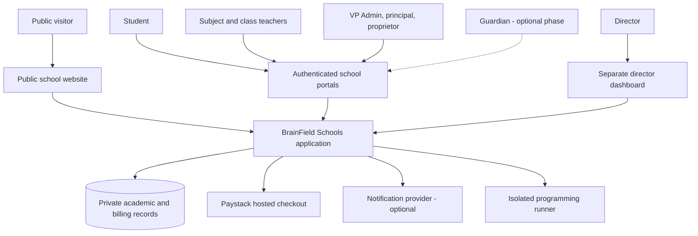
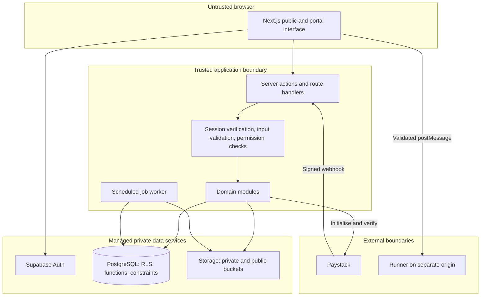
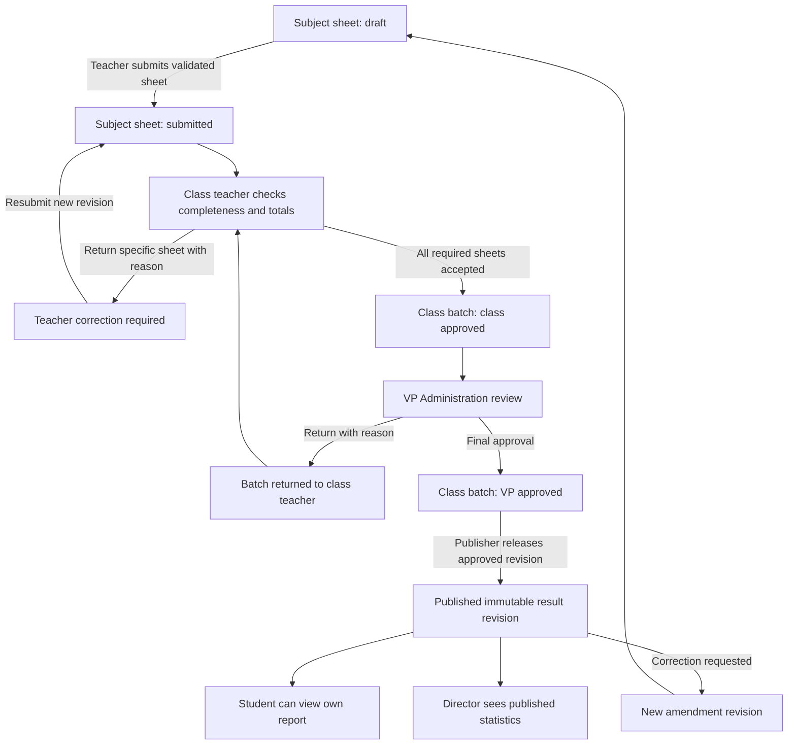
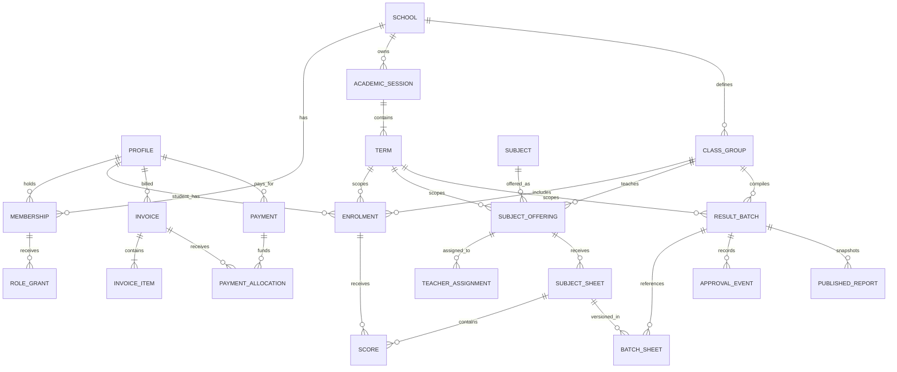
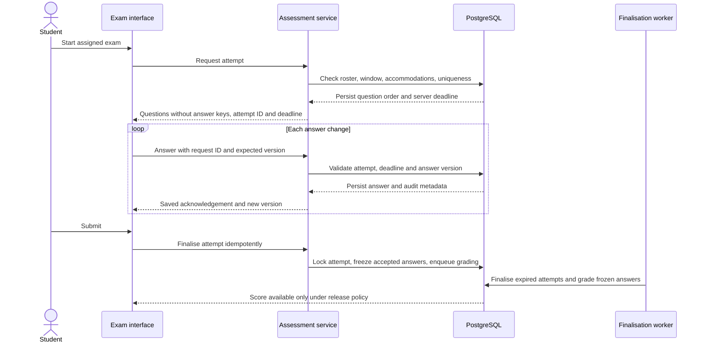
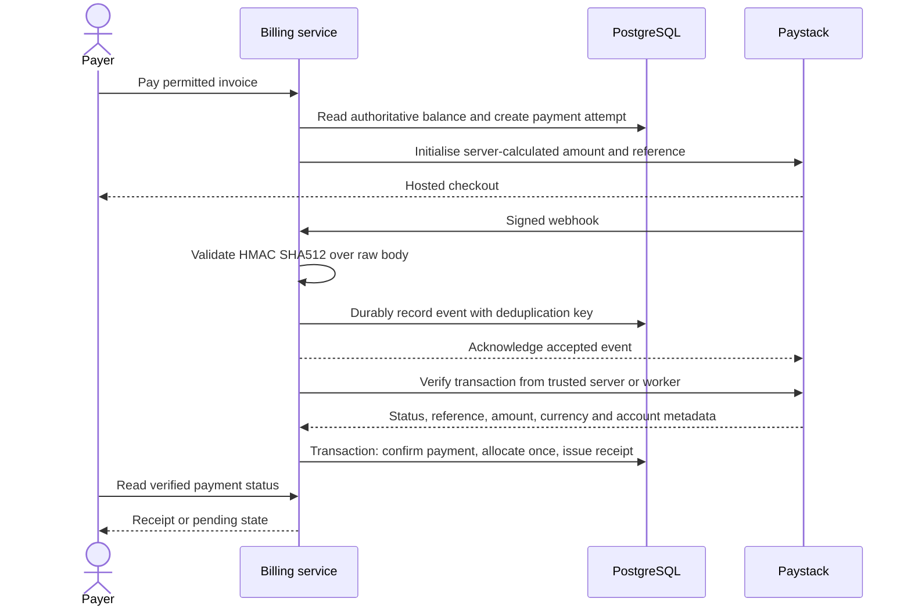
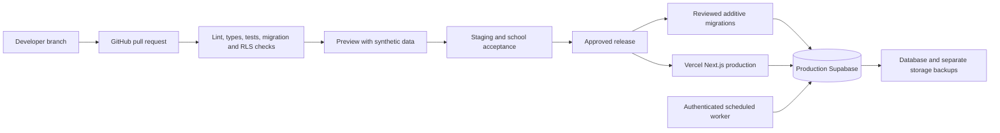

# BrainField Schools — System Architecture

Version 1.0 | 14 October 2026 | Proposed design for school review

This document describes the intended system, not an implemented service. Confirmed requirements come from the founders' discussion. Technology choices and operational policies are proposals until agreed. Learning progress reports are excluded. The director has a separate dashboard. Result approval follows subject teacher, class teacher, then Vice Principal (Administration).

## 1. Architectural approach

Build a modular monolith: one Next.js application with clearly separated domain modules, one PostgreSQL database, managed identity/storage, and a small background worker. This keeps deployment and debugging practical for two developers while preserving boundaries that can be separated later.

The public website and authenticated portals share design components, not unrestricted data access. Business rules live in server-side domain services and constrained database functions. The browser is never trusted to determine roles, marks, invoice balances, exam deadlines, or payment success.

Start with one school and an explicit school identifier on school-owned records. This identifier helps enforce scope; it does not make the app a production-ready multi-tenant SaaS. Multi-school support would require a separate isolation and provisioning review.

## 2. System context

Public visitors see approved school content only. Guardians are an optional extension. The director dashboard is a separate route/navigation area within the same application; it need not be a separately deployed website.

## 3. Components and trust boundaries

Use the signed-in user's database context for ordinary application reads. Supabase privileged secret/service-role credentials bypass RLS and must never be exposed to clients or used as the default for routine portal operations. Limit privileged access to controlled account provisioning and trusted jobs, with explicit school/actor checks and audit entries. In SQL functions, derive the actor from authenticated context rather than a browser-supplied user ID. Lock down grants, function execution, and search paths.

Private document downloads require authorisation and short-lived signed links. Public buckets contain only intentionally published media. Upload policies restrict path, size, MIME type, and ownership; validate content server-side, reject executable files, and scan uploads before broader access where appropriate.

## 4. Domain modules

| Module | Owns | Important boundary |
| --- | --- | --- |
| School and identity | Profiles, roles, sessions, terms, classes, staff assignments | Role changes require privileged authorisation |
| Website content | Facilities, awards, contact details, approved JAMB highlights | Separate drafts from published content |
| Academics/results | Components, scores, submissions, review, approvals, publication | Atomic transitions; published revisions immutable |
| Director reporting | Aggregates from authorised result records | Read-only reporting; no automatic score editing |
| Assessment | Questions, exams, attempt state, answers, grading | Never expose answer keys with active questions |
| Classroom | Timetables, assignments, ICT notes, study plans | Class membership and assignment ownership |
| Competition | Qualification policies, eligible cohorts, tests, selection | Frozen result revision and rule version |
| Finance | Bills, invoices, attempts, confirmed payments, allocations | Provider verification and immutable financial history |
| Programming | Exercises, source submissions, practice runner | Untrusted code execution separated from application |
| Operations | Audit, jobs, notifications, exports | Bounded jobs, retries, and minimal log content |

Modules call documented service interfaces rather than writing each other's tables arbitrarily. For example, CBT can provide a reviewed score import to Results; an exam score must not skip the academic approval chain.

## 5. Roles and permission matrix

Permissions combine role, school, active academic assignment, record ownership, and workflow state. A person may hold several roles, but each grant is explicit and auditable.

| Role | Scores | Approval/publication | Results/statistics | Configuration/finance |
| --- | --- | --- | --- | --- |
| Student | No score editing | None | Own published records | Own bills; initiate own permitted payments |
| Subject teacher | Draft scores for assigned subject/classes | Submit own subject sheet | Assigned academic records | Assigned learning resources |
| Class teacher | Review compiled assigned class | Return subject sheet; class approval | Assigned class results | Class comments if policy allows |
| VP Administration | Review class-approved submissions | Final approval; return to class teacher | Authorised school academic records | Academic oversight |
| Principal | Read according to granted school scope | Publication only if granted | School oversight | Academic configuration if granted |
| Proprietor | No automatic score editing | No automatic approval bypass | Oversight if granted | Organisation oversight |
| Director | Read-only | None by default | Separate school-wide results/statistics dashboard | No automatic financial/configuration privileges |
| Administrator | No implicit academic authority | None unless separately granted | Only necessary authorised access | Accounts, classes, terms, assignments |
| Bursar - proposed | None | None | No automatic academic access | Invoices, allocations, reconciliation |
| Guardian - optional | None | None | Linked child's published results only | Linked child's permitted bills |

A subject teacher who is also a class teacher must not approve their own subject sheet without an independent reviewer. Recommended policy: route that sheet to an appointed reviewer before class approval. The school must appoint that reviewer and decide absence/delegation procedures. Administrative account recovery must not silently grant academic approval rights.

## 6. Result lifecycle and approval rules

Use two connected workflows: subject sheets contain the originating teacher's scores; class result batches compile all required subject sheets. This makes returned corrections precise.

### Validation and atomicity

1. The teacher must be actively assigned to the class-subject offering for the term.
2. Each component score is within its configured maximum; distinguish zero, absent, exempt, and missing.
3. All required students and subjects are accounted for before class approval. Any allowed exception is explicit and recorded.
4. Store raw components and calculation policy version. Example only: a school may choose CA 40 plus examination 60. The school must define its actual policy.
5. Totals, grades, and rankings are computed server-side using a documented rounding and tie policy.
6. Submission locks the teacher's current revision. Reviewers return it with a reason rather than silently rewriting marks.
7. A class batch references exact subject-sheet revisions. A changed source revision invalidates downstream approvals; a previously approved batch cannot quietly pick up new scores.
8. Approve/publish inside a database transaction with state/version checks and a row lock. Write the audit event and notification outbox entry in the same transaction.
9. Final approval does not accidentally publish. Publication is a separately authorised transition, optionally combined by approved school policy.
10. Published report cards are snapshots. Corrections produce a new revision through the same approvals, with an effective timestamp and superseded status for the earlier revision.

Suggested batch states: `compiling`, `class_approved`, `returned`, `vp_approved`, `published`, `superseded`. Suggested sheet states: `draft`, `submitted`, `returned`, `accepted`. State enums alone are insufficient; enforce transitions in database functions and tests.

## 7. Director dashboard and metric definitions

The director receives `/director`, with separate navigation and server-authorised school-wide reporting. Proposed default: published results drive performance statistics. Approval-status counts can include pending batches. Viewing unpublished individual results is an open school policy decision and requires a separate permission and clear status labels.

| Metric | Definition and safeguards |
| --- | --- |
| Submission completion | Submitted required class-subject sheets divided by required sheets for the selected term |
| Approval completion | VP-approved or published class batches divided by expected class batches; show both counts |
| Subject mean | Mean percentage for valid numeric scores in the selected subject/cohort/revision |
| Pass rate | Valid numeric scores meeting the configured pass rule divided by valid numeric scores |
| Grade distribution | Counts in policy-versioned grade bands with total eligible records |
| Class mean | Mean of student percentages using each student's registered subject set; state the weighting policy |
| Term comparison | Compare like cohorts and policy versions; label changed subjects, weights, or membership |

Always show denominators and counts of missing, absent, exempt, or unpublished records. Do not classify an unentered score as zero. Do not average a JSS and SSS cohort indiscriminately. Report timestamps and filters. Provide table alternatives to charts and permission-checked exports. No fabricated live figures, predictive labels, or learning progress reports.

## 8. Conceptual data model

These relationships are a starting model, not an executable migration. UUIDs identify records; admission numbers are school-scoped identifiers. Academic enrolment is historical so promotion does not rewrite old result membership.

### Additional tables and constraints

| Area | Suggested entities and invariants |
| --- | --- |
| Identity | `profiles`, `school_memberships`, `role_grants`, verified optional `guardian_links`; database-owned role grants |
| Academics | Sessions, terms, class groups/streams, enrolments, subjects, subject registrations, teacher/class-teacher assignments, versioned grading policies |
| Results | Versioned subject sheets and scores, batch-sheet junction, approval events, published snapshots; one active sheet revision per offering |
| Exams | Question versions, choices, restricted answer keys, exam versions, exam-question ordering, attempt roster, attempts, answer versions, accommodations |
| Learning | Assignments, submissions, feedback, ICT notes, timetable entries, study-plan entries |
| Competition | Rule versions, qualification runs, cohort members, selection attempts, reviewed decisions |
| Finance | Fee schedules, invoices/items, payment attempts, confirmed payments, allocations, adjustments, refunds, reconciliation events |
| Operations | Append-only audit events, transactional outbox, jobs, notification deliveries, export jobs |

Every school-owned reference must stay within one school. Enforce with composite foreign keys or equivalent constraints, not only application checks. Use uniqueness for enrolment per student/class/term, attempt per assigned sitting, provider transaction reference, and webhook/event processing key. Record timestamps, actor, revision, and status where meaningful. Add indexes for school/term/class queries and measured report filters. Restrict audit updates/deletes to a controlled retention process.

## 9. CBT architecture

The sequence's final availability is delivered through an authorised application read, not direct database push. A server-generated attempt deadline is authoritative; browser clock changes cannot extend it. Persist random question/option order once per attempt, and version exam content before release. Essays require authorised manual grading.

Use retryable, idempotent saves with answer version checks so delayed requests cannot overwrite newer answers. Show saved/unsaved indicators. Resuming an attempt reloads accepted answers and the original deadline. A scheduled job finalises expired attempts even if the student closes the browser. No answer key or immediate solution explanation is sent before the configured release point.

For outages, show disconnection clearly and retain the minimum temporary answer buffer. Clear it after successful submission, logout, or expiration; shared lab computers must not retain another student's answers. Formal exams require a documented outage/accommodation process: late offline submissions are not automatically accepted. Full offline CBT is deferred because synchronisation and exam integrity require a separate design.

Practice exams may allow repeats and feedback; formal exams enforce an assigned sitting and controlled retakes. Load-test at the school's agreed peak simultaneous candidates plus a measured margin. Tab-switch signals may support supervision but cannot prove cheating; invasive camera proctoring is not initial scope.

## 10. Competition qualification

Define subject/class/term scope, published result revision, cutoff, absence rules, selection-test contribution, seat limits, and tie-breaking before running selection. An illustrative cutoff such as 75 percent is not an approved policy.

Qualification runs freeze both the rule version and source result revisions. Students meeting the published criterion become eligible for selection tests and relevant practice. Final membership records an authorised decision and reason for any override. Corrected academic results require a new qualification run or reviewed adjustment; never silently change a published team. Show students their own eligibility and next steps without exposing classmates' marks.

## 11. Timetables, assignments, and ICT notes

School timetables store class, subject, teacher, room, day, and start/end times. Reject overlapping class, teacher, and room bookings, including concurrent edits. Start with manual scheduling plus conflict detection; automatic timetable optimisation is a later project.

Study plans are student-owned entries with subject, available time, recurrence, and exam-date context. Use deterministic suggestions and editable slots; do not reintroduce removed progress reports. ICT notes support draft/review/publish and sanitised rich text. Assignments include scoped recipients, due dates, submission versions, attachment rules, marks, and feedback release. Teachers must not access another class merely by changing an ID in a URL.

## 12. Payments and financial integrity

The callback/redirect is a user-experience signal, not proof of payment. Verification must match success status, expected reference, amount in kobo, NGN currency, invoice mapping, and expected school/payment-account context. The server selects these values before checkout. Never trust invoice balances or paid amounts submitted by the browser.

Durably save a validated webhook before acknowledging it, then process asynchronously if necessary. Use constant-time signature comparison, unique references, transaction locks, and idempotent allocation. Retrying a webhook, verification callback, or job must not credit an invoice twice. Two different successful payments may create overpayment credit; record and review it rather than losing money or making the invoice negative.

Reconcile pending payments through scheduled verification and provider reports. Track refunds, reversals, chargebacks, offline payments, and authorised adjustments with append-only events. Receipt numbers are unique. Payment processor fees and gross/net settlement are distinct from student fee credit. No card details are stored by the school app. Live settlements belong to the school's own merchant account, never a developer's personal account.

## 13. Programming classroom isolation

Provide CodeMirror exercises and submissions first. For HTML/CSS/JavaScript practice, use a sandboxed iframe on a separate origin with restrictive CSP; do not grant access to the portal origin, cookies, or browser storage. Treat console/output as text, validate message origin/source/schema, and never render untrusted HTML into the portal. Disable navigation/popups and unnecessary network access.

For Python practice, Pyodide may run in a module worker inside the separate runner origin. A worker alone is not a security boundary. Terminate execution on a bounded timeout, cap output, restrict package/network access, and test memory behaviour on lab computers. Initial Python downloads may be too large for some users, so make runtime loading explicit and optional.

Browser execution is for practice; students can modify their browser and its claimed results. Authoritative hidden-test grading requires a separately deployed sandbox worker with no application/database secrets, no outbound network by default, ephemeral files, and CPU/memory/time quotas. Do not run submitted code through `eval`, shell commands, or child processes on the application server. Server-side grading is a separately estimated later stage.

## 14. Representative API contracts

The following contracts are design targets; route handlers or server actions may implement them. All require server-side validation and the relevant role/assignment checks.

| Operation | Contract and guarantee |
| --- | --- |
| `POST /api/results/sheets/{id}/submit` | Expected revision; validate all scores; lock and record actor |
| `POST /api/results/batches/{id}/class-approve` | Assigned class teacher; exact accepted sheet revisions |
| `POST /api/results/batches/{id}/vp-approve` | VP Admin; class-approved current revision |
| `POST /api/results/batches/{id}/return` | Required reason; invalidate dependent approvals |
| `POST /api/results/batches/{id}/publish` | Publisher permission; VP-approved revision; immutable snapshot |
| `GET /api/director/results-summary` | Authorised director; validated filters and declared metric basis |
| `POST /api/exams/{id}/attempts` | Assigned student; server deadline; one attempt per sitting |
| `PUT /api/attempts/{id}/answers/{questionId}` | Expected version/request ID; active attempt and question membership |
| `POST /api/invoices/{id}/checkout` | Permitted payer; server-calculated amount/reference |
| `POST /api/payments/paystack/webhook` | Provider signature instead of browser session; durable deduplication |

Use structured error codes, for example `VALIDATION_FAILED`, `FORBIDDEN`, `REVISION_CONFLICT`, `INVALID_TRANSITION`, and `ATTEMPT_EXPIRED`. Include correlation IDs without exposing internal errors. Apply rate limits to login, exports, checkout, and repeated saves. Protect cookie-authenticated mutations against CSRF with framework protections and explicit origin checks as appropriate.

## 15. Deployment and background processing

Production, staging, and local development have separate credentials and data. Untrusted fork previews receive no production secrets. Preview deployments use synthetic records. Deploy compatible code/migrations in reviewed order; never reset production to apply a migration. Prefer expand/migrate/contract changes, and document rollback limitations before release.

The initial worker is a bounded scheduled process deployed as an authenticated server endpoint or dedicated small worker, chosen after verifying current hosting execution limits and scheduling availability. It claims jobs with a lease, processes in small batches, retries with backoff, and moves repeated failures to a review queue. Use unique job keys. Do not execute arbitrary jobs from unauthenticated requests. Long exports or sandbox grading require a dedicated worker when they exceed hosting limits.

Transactional outbox writes ensure the result publication/payment commit and notification request cannot diverge. Notifications contain minimal details and point users to authorised portal pages. Email/SMS is optional; do not make its delivery a prerequisite for viewing a published result.

## 16. Privacy, security, and retention

The school should approve a data inventory, access policy, retention schedule, and privacy notice before real records are imported. Assess applicable Nigerian data-protection requirements and responsibilities with a qualified local adviser. This architecture does not assert legal compliance or a universal lawful basis. Where consent is the appropriate basis for processing children's data, obtain the required guardian consent and record it. Publication of student names, photographs, or JAMB highlights needs a separate approved process.

Use staff MFA for privileged roles, invite-only staff onboarding, verified account recovery, secure session cookies, reauthentication for sensitive actions, and immediate deactivation of departed staff. Students need an appropriate admission-number/account onboarding flow with temporary credentials changed on first use; never derive passwords from birthdays.

Enforce least privilege in both server checks and RLS. Restrict exports and log their scope. Keep credentials in managed secret stores. Sanitise rich text, apply a CSP, scan dependencies, validate uploads, and avoid logging passwords, tokens, payment secrets, or entire student records. Limit bulk downloads and temporary signed-URL lifetimes. Review operator access and exceptional access separately from normal school roles.

Retention must reflect school policy and applicable obligations. Do not erase financial or academic history casually. Approved deletion, anonymisation, and legal-hold processes need audit trails. Public repository contents always remain free of real student data.

## 17. Reliability, backup, and operations

Proposed targets for school agreement: daily recovery points for ordinary academic work, recovery within one school day for a serious outage, and a stricter exam/finance recovery requirement if formal CBT and payments become operational. These are desired targets, not service guarantees. Confirm that the chosen backup plan and processes can meet the agreed values.

Supabase database backups do not include Storage object contents. Back up the database and private file objects separately, protect access/encryption, and test restoration in an isolated environment before launch and regularly thereafter. Keep a manifest linking file backups to database snapshots. Never store backups in this repository.

Monitor failed login spikes, result transition failures, answer-save errors, webhook signature failures, pending payments, overdue jobs, backup freshness, and server errors. Give the school a support contact, escalation path, outage communications procedure, and named account owners. Record incident actions and review them after recovery.

## 18. Quality gates and launch acceptance

- Students cannot read another student's records or any unpublished report.
- Teachers cannot access unassigned subjects/classes by modifying IDs.
- Class approval and VP approval cannot be bypassed; source revisions invalidate dependent approvals.
- Concurrent approval/publication requests create one effective transition and an auditable result.
- Report-card totals, grades, ties, and absence handling match school-approved examples.
- Director metrics reconcile with the same filtered published records and show denominators.
- CBT survives refresh and delayed saves; changed browser clocks do not extend deadlines.
- Payment replay cannot double-credit; wrong amount/currency/reference cannot produce a receipt.
- Programming practice cannot access portal credentials or execute on the app server.
- Keyboard, phone, slow-network, printing, and real lab-computer checks pass.
- Database and file restore are demonstrated; school staff can operate the workflow independently.

## 19. Open decisions before implementation

Confirm enrolment and concurrent CBT capacity; current grading/report-card format; role holders and publisher; director access to unpublished results; independent review for teacher/class-teacher overlap; correction windows; payment/refund/instalment rules; supported programming languages; internet/power constraints; optional modules; data retention; domain/account ownership; maintenance budget; and licence/ownership expectations. See the decision register for owners and proposed defaults.

## 20. Primary references

These support implementation details rather than endorsing the proposal:

- Next.js: https://nextjs.org/docs/app/getting-started/installation
- Deployment: https://nextjs.org/docs/app/getting-started/deploying
- Node.js lifecycle: https://nodejs.org/en/about/previous-releases
- Supabase SSR: https://supabase.com/docs/guides/auth/server-side/nextjs
- RLS: https://supabase.com/docs/guides/database/postgres/row-level-security
- Storage access: https://supabase.com/docs/guides/storage/security/access-control
- Backup scope: https://supabase.com/docs/guides/platform/backups
- Paystack verification: https://paystack.com/docs/payments/verify-payments/
- Paystack webhooks: https://paystack.com/docs/payments/webhooks/
- Pyodide workers: https://pyodide.org/en/stable/usage/webworker.html
- Interface guidelines: https://vercel.com/design/guidelines
- NDPC annual report, including discussion of children's data: https://ndpc.gov.ng/wp-content/uploads/2025/01/NDPC-Annual-Report-2024.pdf

Checked 14 October 2026. Provider features and legal obligations must be verified again before launch.
